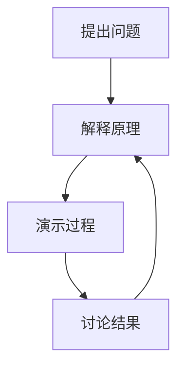

---
presentation:
  theme: studio
  motion: cinematic
  speed: 1
  autoplay: true
---

# 让课堂跟随讲解

<!-- preface:
**Coach · 展示效果示例**

- 主题与入场效果
- 动态图示与数学公式
- 可以循环播放和暂停的场景
-->
<!-- speaker: 本例展示如何在一份 Markdown 中使用主题、动画和内容插件。通过工具栏的调色板选择主题与入场效果。 -->

## 文字与视觉节奏
<!-- speaker: 普通 Markdown 也能使用不同的入场效果。 -->

### 把注意力放在当前内容
<!-- speaker: 当前的标题通过幕布展开进入画面。 -->

文字可以 :highlight[逐步强调]，也可以用 :circle[圈画] 提示讨论对象。
<!-- speaker: 圈画与高亮仍然保留，并能配合所选主题展示。 -->

| 讲解动作 | 课堂控制 |
| --- | --- |
| 继续讲解 | 右方向键 |
| 返回内容 | 左方向键 |
| 停下动画 | 暂停动效 |
<!-- speaker: 讲解进度由方向键控制。需要停下来解释时，可以暂停动效。 -->

## 动态图示与公式
<!-- speaker: Mermaid 和 KaTeX 可以直接写进 Markdown。 -->


<!-- speaker: 连接线依次出现，并且循环展示。可以使用工具栏的暂停按钮停在需要讲解的画面。 -->

```math
\text{比例} = \frac{180-15}{180}\times100\% \approx 91.67\%
```
<!-- speaker: 公式保留矢量文字，放大后仍可阅读。 -->

## 时间可以停下来
<!-- speaker: 复杂 HTML、GSAP 或 WebGL 场景可以通过统一的时间接口播放。 -->

```coach-scene
src: ./assets/classroom-scene.html
poster: ./assets/classroom-scene-poster.png
title: 讲解的节奏
width: 1280
height: 720
duration: 12
fps: 60
```
<!-- speaker: 这段 HTML 场景循环展示文字和面板的入场。可以使用工具栏的暂停按钮停下来解释。静态导出使用配套封面。 -->

## 视频片段
<!-- speaker: 已制作的视频可以按片段插入课堂。 -->

```coach-video
src: ./assets/classroom-scene.webm
poster: ./assets/classroom-scene-poster.png
title: 课堂场景的视频版本
duration: 8
```
<!-- speaker: 视频与讲解步骤关联，离开当前步骤时停止推进。静态导出保留当前视频画面。 -->
