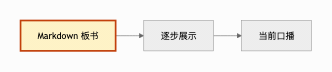

# 图示与动图
<!-- preface: **学习目标**：展示静态关系和依次强调的动态过程。 -->
<!-- speaker: 这份示例使用本地 SVG 和 GIF 素材。 -->

## 静态关系
<!-- speaker: 沿着箭头观察从文件到画布，再到口播的关系。 -->

<!-- speaker: Markdown 保存板书和讲解内容，Coach 根据当前步骤展示它们。 -->

## 动态过程
<!-- speaker: 观察动图中依次强调的节点。 -->

<!-- speaker: 先观察输入，再观察展示，最后观察口播。让动图播放一个完整循环。 -->
